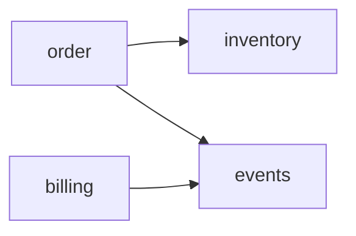
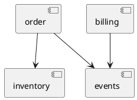

# Chapter 6: Visualizing the Vibe

## Core Idea
Guardrails enforce structure but don't show it; at AI speed the architect's mental model falls behind the code even when every test passes. Make architecture diagrams a generated, text-based output of the build so the picture is never more than one build old — telemetry for comprehension, complementing tests for enforcement.

## Frameworks Introduced
- **Diagrams Are an Output of the Build**: derive the diagram from the code on every build instead of maintaining it beside the code.
  - When to use: any vibe-coded system where AI diffs span many files and you merge on green tests.
  - How: (1) generate diagrams from code in the existing test/compile step (Spring Modulith `Documenter`, jQAssistant, or an AST pass); (2) emit a text format (PlantUML, Mermaid, DOT); (3) write output to a tracked location so a PR that changes the diagram is by definition a PR that changed the architecture; (4) never make generation optional — the moment it is, it rots.
- **Intended vs Actual Architecture (C4 as code)**: keep a human-authored intended model (Structurizr/C4) next to the generated actual one.
  - When to use: when you need an explicit "the AI built something other than what we designed" signal.
  - How: version both as text; diff them; treat divergence as a review item.
- **Text Diagrams as a Two-Way Artifact**: the same file is telemetry out and intent in.
  - When to use: every prompt that touches module structure, and at design time.
  - How: *Code → diagram*: the build regenerates `components.puml`, you read it. *Diagram → model*: paste it into the prompt as a token-cheap constraint ("here is the current module structure; add the notification feature without introducing any edge into `billing`"), or ask the model to propose its design as a Mermaid diagram first, review the picture, then say "build that."
- **IDE Preview as Fast Feedback**: keep `components.puml` open in a live preview pane beside the code.
  - When to use: during active AI sessions.
  - How: the build runs in its normal loop, the preview updates, and a new arrow between modules is peripheral-vision feedback that a boundary was crossed — before you read the diff.

## Key Concepts
- **Mental model drift**: merging clean, green AI diffs repeatedly until you are the architect of a system you no longer have a picture of; nothing broke, the code outran your tracking.
- **Architectural telemetry**: automated, build-generated views that restore situational awareness; pure observation, prevents nothing.
- **Spring Modulith `Documenter`**: writes module diagrams (`components.puml`), per-module PlantUML and module canvases from the test run.
- **jQAssistant**: scans bytecode into a queryable model and emits PlantUML; layer rules double as diagram definitions.
- **AST diagram pass**: JavaParser or tree-sitter walk emitting a Mermaid graph of inter-package references; an afternoon's work.
- **Text-to-diagram language**: PlantUML/Mermaid; the text is the diagram, the picture is just a rendering.
- **Diagram diff**: an architectural change appears in a PR as one added line (`+ billing --> order`) rather than an unnoticed pixel shift.
- **Enforcement vs comprehension**: Ch 5 tests answer "did the AI cross a line?"; living diagrams answer "what does my system look like now?"

## Mental Models
- A diagram maintained by hand is a diagram that is already wrong: generated, or not worth having.
- Think of the diagram the way Ch 3/4 treat generated guardrail files: no manual step means no way to fall behind.
- Use a diagram in the prompt instead of the twenty files it summarizes — orders of magnitude cheaper and a precise statement of the shape to respect.
- Ten lines of proposed diagram are reviewable in a way ten files of speculative code never are; a wrong arrow is cheapest to delete while it is still text in a chat window.

## Anti-patterns
- **Hand-drawn diagrams stored elsewhere**: same structural defect as hand-edited CLAUDE.md — a description separated from the code drifts.
- **Binary exports (PNG, Visio, whiteboard photos)**: cannot be diffed, versioned meaningfully, regenerated by a build, or edited by the model with one-line precision.
- **Optional/manual diagram generation**: "hand-drawn diagrams with extra steps."
- **Treating telemetry as a guardrail that prevents**: a living diagram prevents nothing; pair it with Ch 5 enforcement.

## Code Examples
```java
class ModularityTests {
  static final ApplicationModules modules =
      ApplicationModules.of(ECommerceApplication.class);

  @Test void verifiesModularStructure() { modules.verify(); }

  @Test void writesDocumentation() {
    new Documenter(modules)
        .writeModulesAsPlantUml()            // target/.../components.puml
        .writeIndividualModulesAsPlantUml()
        .writeModuleCanvases();
  }
}
```
- **What it demonstrates**: enforcement and telemetry produced by the same test run the AI already executes.



- **What it demonstrates**: a complete component diagram is a few lines of diffable, LLM-fluent text; GitHub/GitLab render Mermaid natively in Markdown.

## Reference Tables
| Generator | Input | Output | Notes |
|---|---|---|---|
| Spring Modulith `Documenter` | Spring modules (test run) | PlantUML, module canvases | Same test as `modules.verify()` |
| jQAssistant | Compiled bytecode | PlantUML | Package/layer rules double as diagram definitions |
| JavaParser / tree-sitter AST pass | Source (polyglot with tree-sitter) | Mermaid | Wire into Maven/Gradle lifecycle |
| Structurizr / C4 as code | Human-authored model | Intended architecture | Diff against generated actual |

**Two properties that make a diagram a guardrail, not decoration**: (1) text format in version control; (2) generation wired into the build.

## Worked Example
**An unwanted edge caught by the picture.** The AI adds a dependency from `order` to `billing.internal`. On the next `mvn test` in the same cycle: `verifiesModularStructure` fails (Ch 5 enforcement), and `components.puml` regenerates with a new arrow that wasn't there yesterday (Ch 6 telemetry). With the file open in the IDE preview, the architect sees the arrow appear before reading the diff; in the PR, the change shows as one added line. The architect never reconstructs the structural change from twenty files.

**Design-time inversion**: ask the model to propose the notification feature as a Mermaid diagram, review and correct arrows in the chat, then say "build that"; afterwards the regenerated diagram confirms whether the built shape matches.

## Why It Works / Failure Mode
- **Diagrams as build output**: the human-paced sync between writing and mental model breaks at AI speed; regenerating from code on every build removes the manual step that could fall behind, converting the mental model from something maintained by discipline into something the build maintains. Fails when generation is optional, output is binary, or diagrams are not committed, so no diff exists to review.
- **Limit**: pure telemetry — it restores situational awareness so judgment calls (what to lock, where to draw boundaries, which contract to freeze) are made by someone who can still see the system, but it blocks nothing on its own.

## Key Takeaways
1. Passing every guardrail doesn't mean you still understand the system's shape; protect the mental model explicitly.
2. Generate diagrams from code in the build; hand-maintained diagrams are already wrong.
3. Use text formats (PlantUML/Mermaid/DOT) committed to version control so architecture changes surface as PR diffs.
4. Use diagrams both ways: as telemetry from the build and as a cheap, precise constraint in prompts or a design proposal before code.
5. Keep a live IDE preview open so boundary crossings appear in peripheral vision.
6. Pair comprehension (diagrams) with enforcement (Ch 5 tests); a vibe-coded project needs both.

## Connects To
- **Ch 3**: hand-edited CLAUDE.md files drift for the same reason hand-drawn diagrams do.
- **Ch 4**: generated guardrail files from annotations — same "no manual step" principle.
- **Ch 5**: `modules.verify()` is the enforcement half of the same test.
- **Ch 5c**: patterns whose structure these diagrams render.
- **Ch 7**: the diagram round trip (telemetry out, intent in) is Spec-Driven Development in miniature.
- **Ch 8b**: CodeKarta extends visual telemetry (coverage heat maps).
- **C4 model / Structurizr (Simon Brown)**, **Living Documentation (Martraire)**, **situational awareness**.
